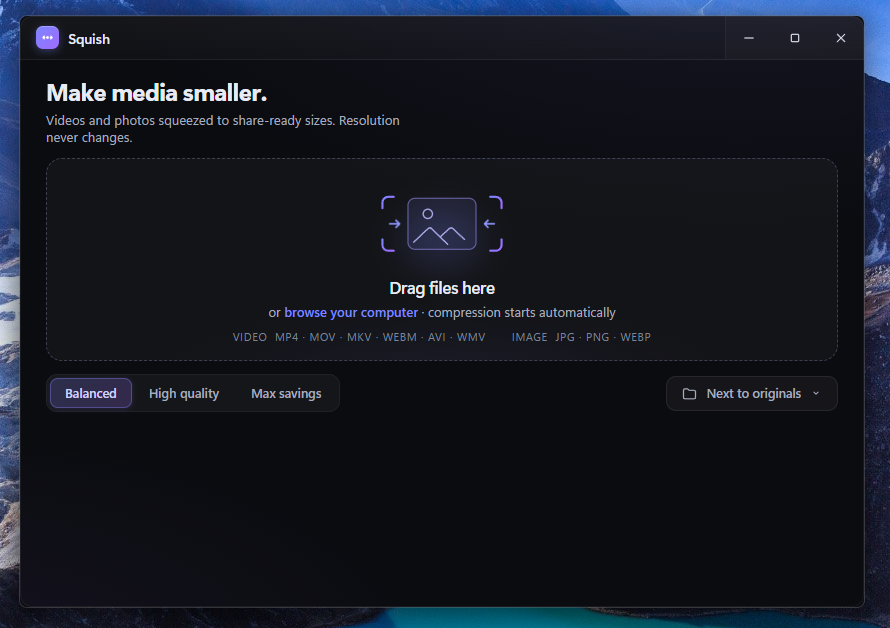

# معرفی فشرده‌ساز Squish

برنامه **Squish** یک ابزار سبک ویندوز برای کاهش حجم تصویر و ویدئو است. پردازش فایل‌ها به‌صورت محلی انجام می‌شود و هیچ فایل رسانه‌ای به سرور فرستاده نمی‌شود.

کاربر می‌تواند فایل‌ها را روی پنجره رها کند. فشرده‌سازی بلافاصله شروع می‌شود و اندازه قبل، اندازه بعد و مقدار صرفه‌جویی برای هر فایل نمایش داده می‌شود.

## نمای برنامه



## قابلیت‌های اصلی

- فشرده‌سازی چند فایل در یک صف را پشتیبانی می‌کند.
- کشیدن و رهاکردن فایل و انتخاب از پنجره فایل را پشتیبانی می‌کند.
- سه حالت کیفیت بالا، متعادل و بیشترین فشرده‌سازی را ارائه می‌دهد.
- فرمت‌های تصویری JPG، JPEG، PNG و WebP را پردازش می‌کند.
- فرمت‌های ویدئویی MP4، MOV، M4V، MKV، WebM، AVI، WMV، FLV، MPG، MPEG، TS، M2TS و 3GP را می‌پذیرد.
- ویدئوها را به MP4 با ویدئوی H.264 و صدای AAC تبدیل می‌کند.
- چرخش ثبت‌شده در داده EXIF تصویر JPEG را حفظ می‌کند.
- فایل خروجی را کنار فایل اصلی یا داخل پوشه انتخابی ذخیره می‌کند.
- نام فایل موجود را بازنویسی نمی‌کند و یک نام یکتا می‌سازد.
- عملیات در حال اجرا را لغو می‌کند و خروجی ناقص را پاک می‌کند.
- فایل بزرگ‌تر از نسخه اصلی را نگه نمی‌دارد و وضعیت «بهینه» را گزارش می‌کند.

## فناوری‌های استفاده‌شده

- پوسته دسکتاپ با **Tauri 2** ساخته شده است.
- منطق اصلی با **Rust 2021** نوشته شده است.
- رابط کاربری با **HTML**، **CSS** و **JavaScript** اجرا می‌شود.
- پردازش ویدئو و WebP با **FFmpeg** انجام می‌شود.
- پردازش JPEG با crate نرم‌افزاری `image` انجام می‌شود.
- بهینه‌سازی PNG با crate نرم‌افزاری `oxipng` انجام می‌شود.
- بسته نصب ویندوز با **NSIS** ساخته می‌شود.
- نمایش رابط با **Microsoft Edge WebView2** انجام می‌شود.

## نصب برای کاربران

روش پیشنهادی، دریافت فایل `Installer/Squish_1.0.1_x64-setup.exe` از همین مخزن گیت‌هاب است. سپس کاربر فایل را اجرا می‌کند و مراحل نصب را ادامه می‌دهد. همین نصب‌کننده همه فایل‌های لازم برای استفاده عادی را نصب می‌کند.

نصب‌کننده فعلی گواهی Authenticode ندارد. بنابراین ویندوز ممکن است هنگام نخستین اجرا هشدار SmartScreen نشان دهد.

## اجرا از سورس

پیش‌نیازها شامل ویندوز ۱۰ یا ۱۱ نسخه ۶۴ بیتی، نسخه LTS نرم‌افزار Node.js، ابزار Rust با زنجیره MSVC، ابزارهای ساخت C++ ویژوال استودیو و WebView2 Runtime هستند.

توسعه‌دهنده باید FFmpeg ویندوز ۶۴ بیتی دارای `libx264`، `aac` و `libwebp` را نصب کند. سپس توسعه‌دهنده فایل `ffmpeg.exe` را در مسیر زیر قرار می‌دهد:

```text
Source Code/src-tauri/binaries/ffmpeg.exe
```

فرمان‌های زیر وابستگی‌ها را نصب و برنامه را اجرا می‌کنند:

```powershell
cd "Source Code"
npm ci
npm run dev
```

متغیر محیطی `SQUISH_FFMPEG` می‌تواند مسیر FFmpeg را هنگام توسعه مشخص کند.

## ساخت نسخه انتشار

فرمان زیر فایل نصب را از سورس می‌سازد و در پوشه `Installer` قرار می‌دهد:

```powershell
cd "Source Code"
npm run build
```

اسکریپت ساخت هماهنگی نسخه را میان `package.json`، فایل `Cargo.toml` و فایل `tauri.conf.json` بررسی می‌کند.

## حریم خصوصی

برنامه همه پردازش‌ها را روی رایانه کاربر انجام می‌دهد. برنامه به حساب، کلید API یا سرویس ابری نیاز ندارد.

## محتوای مخزن

- پوشه `Source Code` شامل رابط کاربری، منطق Rust و ابزارهای ساخت است.
- پوشه `Installer` شامل فایل اصلی `Squish_1.0.1_x64-setup.exe` است.

## ساختار پروژه

```text
Source Code/ui/                  رابط کاربری
Source Code/src-tauri/src/       منطق Rust
Source Code/src-tauri/binaries/  وابستگی‌های باینری محلی
Source Code/tools/               ابزارهای ساخت و همگام‌سازی انتشار
Installer/                       فایل نصب اصلی قابل‌دریافت از گیت‌هاب
```

## مجوز

مالک پروژه هنوز مجوز عمومی مشخصی برای این مخزن تعیین نکرده است. بنابراین استفاده، تغییر یا بازتوزیع کد به اجازه مالک نیاز دارد.
